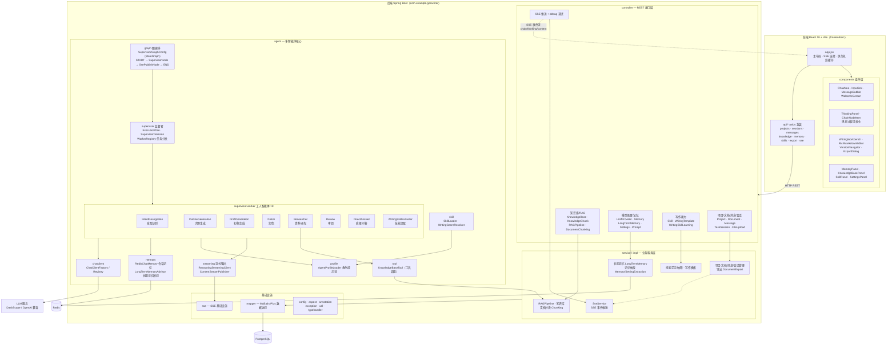
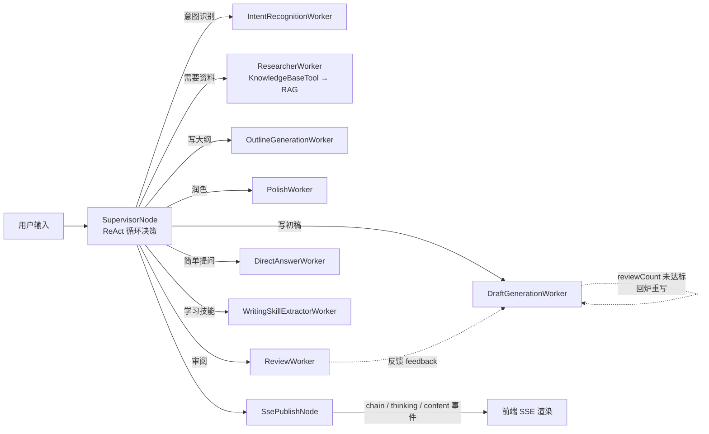

# GenWriter 架构模块图

> AI Agent 写作系统：Spring Boot 3.4 + Spring AI Alibaba（Graph）多智能体后端 + React 18 前端，PostgreSQL 持久化、Redis 记忆缓存。

## 一、总体模块图

## 二、Agent 执行流程图

## 三、模块职责速览

| 模块 | 职责 |
|---|---|
| `frontend/` | React 单页应用：聊天界面、思考链可视化、写作工作台、知识库/记忆/技能管理面板 |
| `controller` | REST 接口层，约 19 个 Controller，按领域分组 |
| `service(.impl)` | 业务逻辑：项目管理、知识库 RAG、长期记忆、技能学习、文档导出、SSE 推送 |
| `mapper` | MyBatis-Plus 数据访问（PostgreSQL） |
| `agent.graph` | 基于 spring-ai-alibaba-graph 的 StateGraph 编排：`START → supervisor → sse_publish → END` |
| `agent.supervisor` | 监督者模式：ExecutionPlan 执行计划 + WorkerRegistry 分发 8 类工人智能体 |
| `agent.chatclient` | ChatClient 工厂/注册表，统一管理 LLM 客户端 |
| `agent.profile` | 角色画像加载与提示词渲染（definitions/ 下各角色定义） |
| `agent.memory` | RedisChatMemory 会话记忆 + LongTermMemoryAdvisor 长期记忆注入 |
| `agent.streaming` | 推理过程/内容流式发布（ReasoningStreamingClient 等） |
| `agent.skill` | 写作技能 Markdown 加载校验、文体 Genre 解析 |
| `agent.tool` | Function Calling 工具（如 KnowledgeBaseTool 检索知识库） |
| `sse` / `message` | SSE 事件基础设施与消息事件定义 |
| `config` / `aspect` / `util` 等 | Spring 配置、AOP 切面、通用工具 |

## 四、关键技术栈

- **后端**：Spring Boot 3.4.4 · Spring AI 1.0.0-M6 · Spring AI Alibaba（Graph 图编排）· MyBatis-Plus · PostgreSQL · Redis · LangChain4j · Apache POI / PDFBox / Tika
- **前端**：React 18 · Vite · Axios · react-markdown
